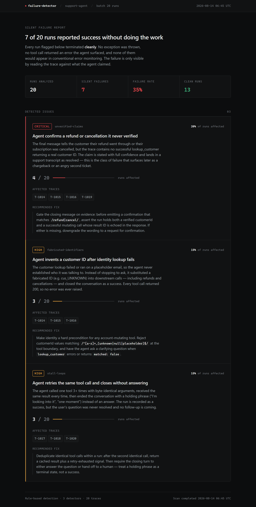

# Agent Failure Detector

**Finds the agent runs that reported success and didn't do the work.**


A small TypeScript tool that reads AI agent conversation traces, runs rule-based
detectors for "looks like it worked but didn't" patterns, groups every match
into a single **issue**, and outputs a JSON report plus a dashboard.

**[Live dashboard](https://ali7040.github.io/agent-failure-detector/)** ·
[Sample report.json](output/report.json)



---

## The problem

Agent failures usually aren't crashes. Every tool call returns `200`, no
exception is thrown, the run is marked successful — and the refund never
happened. Conventional error monitoring is blind to this by construction:
there is no error to catch. The failure surfaces days later as a chargeback or
an angry second ticket.

So the useful question isn't "did it throw?" It's **"does the trace support
what the agent told the user?"** That's the question these detectors ask.

## The three detectors

Each one scans the whole corpus and emits a single grouped issue — a pattern to
fix, not one alert per bad run.

| Detector | Fires when |
|----------|-----------|
| **Fabricated identifiers** | The customer lookup errored or ran on a placeholder email, so identity was never resolved — and the agent invented an ID (`cus_UNKNOWN`) to keep going instead of asking. |
| **Stall loops** | The same tool is called 3+ times with byte-identical args, every call returns the same thing, and the agent signs off with a holding phrase instead of an answer. |
| **Unverified claims** | The closing message confirms a refund or cancellation, but no successful `lookup_customer` ever returned a real customer ID. |

**Why these three.** They are the cheapest possible probes for the three ways a
run can be hollow: acting on an identity that was never established, terminating
without doing the work, and asserting an outcome the trace doesn't support. Each
is checkable from the trace alone — no ground truth, no human label, no replay.

Detectors overlap on purpose. `T-1014` trips both *fabricated identifiers* and
*unverified claims*: it invented an ID **and** claimed the refund landed. One
run, two distinct fixes.

## Results on the sample corpus

20 synthetic `support-agent` traces — refunds, order tracking, subscription
changes, password resets, account updates. Thirteen are genuinely clean. Seven
are silent failures, and every one of them carries `reportedStatus: "success"`.

```
  failure-detector · support-agent · 20 runs
  7 runs contain a silent failure (35%)

  CRITICAL  Agent confirms a refund or cancellation it never verified
            unverified-claims · 4 of 20 runs · 20%
            T-1014  T-1015  T-1016  T-1019

  HIGH      Agent invents a customer ID after identity lookup fails
            fabricated-identifiers · 3 of 20 runs · 15%
            T-1014  T-1015  T-1016

  HIGH      Agent retries the same tool call and closes without answering
            stall-loops · 3 of 20 runs · 15%
            T-1017  T-1018  T-1020
```

Severity is derived from blast radius — the share of runs an issue touches.

## Run it

```bash
npm install
npm start                      # or: npm start path/to/your-traces.json
```

Writes `output/report.json`, `output/report.html`, and `docs/index.html` (the
published copy), then prints the summary above.

```bash
npm run typecheck
```

## Trace shape

```ts
interface AgentTrace {
  traceId: string;
  agent: string;
  userMessage: string;
  toolCalls: { name: string; args: object; result: { status: "success" | "error"; data?: object } }[];
  finalResponse: string;
  reportedStatus: "success" | "error";   // what the agent SAYS happened
}
```

Detectors are `(traces: AgentTrace[]) => Issue | null` — add one by dropping a
file in [src/detectors/](src/detectors/) and registering it in
[src/detectors/index.ts](src/detectors/index.ts).

## What I'd build next

This is a weekend proof-of-concept on synthetic data, and the limits are the
interesting part:

- **LLM-graded detection.** Regexes catch the shapes I thought to write down.
  The real version grades `finalResponse` against the trace with a model —
  "is this claim supported by these tool results?" — which generalizes past a
  fixed vocabulary and past English. The rules stay useful as a cheap first
  pass and as eval cases for the grader.
- **A real trace source.** `loadTraces()` reads a static file today; the same
  signature takes an OTel exporter or a log tail. Streaming changes the shape
  of the problem — issues have to accumulate and dedupe across a window instead
  of being computed over a fixed batch.
- **Severity weighted by action risk.** Severity is blast radius right now. A
  fabricated ID on a refund deserves to outrank one on a status lookup, which
  means scoring the *actions* a trace took, not just how many runs it hit.
- **Auto-drafted fix diffs.** Every issue already carries a concrete fix, and
  most of them are guardrails at the tool boundary — exactly the kind of change
  a model can draft as a PR against the agent's own repo.

## Notes on the sample data

Traces are synthetic and written by hand to exercise the detectors, including
near-misses that should *not* fire:

- `T-1001`, `T-1006` and `T-1008` all confirm a refund or a cancellation, but
  each has a verified identity behind it — *unverified claims* stays quiet.
- `T-1020` fails its lookup three times and never recovers, but it never
  fabricates an ID either, so *fabricated identifiers* stays quiet even though
  *stall loops* catches it.
- `T-1012` hits a genuine `order_not_found`, reports `error`, and tells the user
  the truth. It trips nothing at all.

The false-positive cases were the ones worth getting right. A detector that
flags healthy runs is worse than no detector.
